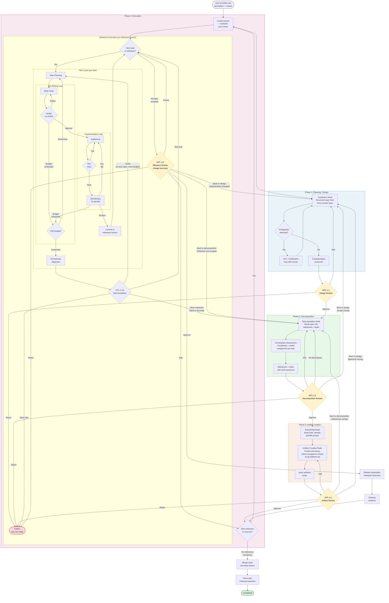

## Overview

This skill defines a system for formalizing a programmatic, orchestrated agentic workflow. The workflow is defined as a natural-language skill document that instructs AI coding agents (e.g., Claude Code) to follow a test-driven development loop with specialized subagents for planning, test writing, implementation, and review. This is a structured, stateful, graph-based orchestration system that provides:

- **Durable execution** across long-running, multi-phase coding work
- **Milestone-scoped human review** where the human reviews completed milestones (small, independently reviewable chunks of work) rather than approving individual agent steps
- **Three-level work hierarchy** (Epic > Milestone > Task) where epics are planned collaboratively, milestones are the unit of human review, and tasks are the unit of agent execution
- **Agent specialization** via subagent delegation with context isolation
- **Persistence and recoverability** so work survives failures and session boundaries

The key design principle is **minimal human interaction**: the workflow runs autonomously through task-level TDD cycles (planning, testing, implementation, and verification by an agent council), then presents the completed milestone — the cumulative output of all its tasks — to a human for review. The human is only consulted when a task can't converge autonomously (escalation) or when a milestone is ready for review. The human's role is to verify milestone output and provide guidance when agents get stuck, not to approve each internal step.

## Background

### Integration Points

- **bd (beads)**: The **long-term memory and audit trail** for the entire workflow. bd is not just issue tracking — it is the persistent, version-controlled (Dolt-backed) record of:
  - The **implementation plan** (decomposition, milestone specs, acceptance criteria)
  - Every **action performed** (phase transitions, loop iterations, subagent invocations, decisions)
  - All **feedback** (verifier rejections, review results, human revision comments)
  - **Accumulated context** that survives across sessions, crashes, and agent restarts
  
  bd task comments serve as the structured log that any agent (or human) can read to understand what happened, what was decided, and why. This is critical because LangGraph's in-memory state and checkpointer are runtime artifacts — bd is the durable, human-readable source of truth that outlives any single workflow execution.

- **Git**: Version control for code artifacts. Each milestone is a stacked branch; each approval is a commit.
- **LLM providers**: The orchestration system needs to invoke LLMs for each specialized subagent role.
- **File system**: Code, tests, and plans live on disk (in worktrees). Agents need file read/write/edit capabilities.

## Design

> **Terminology note:** Throughout this document, terms like "epic issue", "milestone issue", "task issue", "sub-issues", and "comments" refer to artifacts managed by the **configured memory backend** — bd (beads) by default. The design is backend-agnostic unless explicitly noted. See the "Memory backend interface" in Open Question 1 for the full abstraction.

### Orchestrator Agent

The orchestrator is an LLM-backed agent that sits above the graph execution and makes **meta-decisions** about how the workflow should be configured and adapted. It is not a graph node that runs once — it is consulted at key decision points throughout the workflow.

**Core responsibility: complexity assessment and delegation**

The orchestrator evaluates each task (and the overall epic) to determine:
- **Model assignment** for each subagent role
- **Iteration budget adjustments** (override defaults for complex tasks)
- **Parallelism decisions** (should a complex task run solo to avoid wasted rebase work?)
- **Escalation recommendations** (flag tasks that are likely to need human guidance)

**Guiding principle: verification is harder than generation**

Implementation (code writing) is generally the easier problem — the agent has a plan and tests to guide it. Verification (test writing against acceptance criteria, correctness review, security review) is the harder problem because it requires reasoning about completeness, edge cases, and subtle correctness properties. Model allocation should reflect this:

| Role | Difficulty | Default model tier | Rationale |
|---|---|---|---|
| Exploration | Low | Fast/cheap | Codebase scanning, pattern matching |
| Implementation | Medium | Mid-tier | Guided by plan + tests; constrained problem |
| Planning | Medium-High | Strong | Decomposition and plan quality drive everything downstream |
| Test writing | High | Strong | Must reason about acceptance criteria completeness and edge cases |
| Test verification | High | Strong | Must critically evaluate whether tests actually cover the spec |
| Correctness review | High | Strong | Must reason about whether implementation satisfies the spec |
| Quality review | Medium | Mid-tier | Pattern matching against coding standards |
| Security review | High | Strong | Must reason about attack surfaces, subtle vulnerabilities |

The orchestrator can **override these defaults** based on complexity assessment. For a trivial task (rename a function, update a constant), all roles might use the cheapest model. For a task involving cryptographic code or concurrent data structures, all roles might use the strongest available model.

**Interaction with HITL**

The orchestrator pairs with the human at two points:

1. **After decomposition**: The orchestrator presents its complexity assessment and model allocation plan alongside the decomposition. The human can override (e.g., "the auth tasks involve crypto — use the strongest model for everything").
2. **On escalation**: When a TDD cycle hits its retry budget, the orchestrator provides the human with a diagnosis: "Test verification keeps failing because the acceptance criteria are ambiguous" or "The implementation approach may be wrong — consider X". This is more useful than a raw failure dump.

**State:**
```python
class TaskConfig(TypedDict):
    """Per-task configuration, set by the orchestrator."""
    complexity: Literal["trivial", "low", "medium", "high", "critical"]
    model_assignments: dict[str, str]      # role -> tier name (e.g. "strong", "mid", "fast"); resolved via ModelTierConfig
    iteration_overrides: dict[str, int]    # limit name -> override value
    orchestrator_notes: str                # reasoning for the human to review
```

### Agent Councils

The workflow uses two distinct councils — groups of parallel review subagents with deliberately different perspectives. Councils are a core architectural pattern: they exist to prevent the failure mode where a single agent evaluates its own work or converges on a narrow perspective. Each council member runs independently (no access to other members' outputs) and produces structured feedback that is **presented to the human, not used to autonomously modify the artifact under review**.

Both councils use **differential prompting**: each member is explicitly prompted to challenge from a specific angle, not to reach consensus. This avoids the echo chamber problem where multiple agents converge on the same assessment.

#### Deliberation Council

**When:** Phase 1 (design review) and Phase 2 (decomposition review).

**Purpose:** Challenges whether the spec is *right* and whether it is *decomposable into reviewable milestones*. Operates on the `TranslatedSpec` (Phase 1) and the proposed milestone plan (Phase 2).

| Role | Prompt orientation | What it challenges | Example output |
|---|---|---|---|
| **Skeptic** | "What's missing? What assumptions are being made? What will go wrong?" | Gaps in the spec, unstated assumptions, edge cases, failure modes, risks that aren't addressed | "The spec assumes the database supports transactions, but the current schema uses eventual consistency. What happens if writes are partially applied?" |
| **User advocate** | "How will this be used? What does the end user actually need? Is this solving the right problem?" | Scope drift, over-engineering, misaligned requirements, UX implications, cases where the spec solves a technical problem but misses the user's actual need | "The spec adds a config file for notification preferences, but users will expect a UI toggle. Is the intent to add UI later, or is CLI-only acceptable?" |
| **Maintainer** | "How will this be maintained long-term? What are the architectural implications?" | Technical debt, integration risks, backward compatibility, operational concerns, coupling to specific implementations, testability | "This introduces a direct dependency on the Redis client in the API layer. Should there be an abstraction so the session store is swappable?" |
| **Complexity evaluator** | "Is this decomposable into reviewable milestones? Where are the natural seam lines?" | Scope too broad to decompose cleanly, too many concerns interleaved, behavioral and structural changes mixed, areas where the spec will force scattered changes | "This spec mixes a data model migration with new API endpoints. These should be separate milestones — the migration is structural, the endpoints are behavioral." |

The skeptic, user advocate, and maintainer challenge whether the spec is *correct and complete*. The complexity evaluator challenges whether it is *structured for execution* — whether the work it describes can be broken into milestones that a human can review in manageable chunks.

In Phase 2, the complexity evaluator has additional responsibilities: it evaluates the proposed milestone boundaries against the four reviewability dimensions (concept count, concern count, change scatter, behavioral vs. structural) and flags milestones that seem too broad or poorly bounded. See "Granularity: Milestones vs Tasks" for the dimension definitions. The complexity evaluator produces a standard `DeliberationFeedback` — the same schema as every other council member. Its concerns and suggested changes *are* the complexity assessment. There is no separate scorecard: the dimensions are inherently subjective (what counts as a "new concept" or whether a change is "scattered" are judgment calls), and a structured schema with numeric fields would imply false precision.

```python
class DeliberationFeedback(TypedDict):
    role: Literal["skeptic", "user_advocate", "maintainer", "complexity_evaluator"]
    concerns: list[str]           # specific issues found
    questions: list[str]          # questions for the human
    suggested_changes: list[str]  # proposed edits to the spec
    confidence: Literal["low", "medium", "high"]  # how concerned is this reviewer
```

#### Verifying Agent Council

**When:** Phase 4 (TDD cycle self-review), after implementation is complete for each task.

**Purpose:** Evaluates whether an implementation *satisfies its spec*. Operates on the task's code changes (diff), test results, and the task spec's acceptance criteria. All three members must pass for the TDD cycle to succeed.

| Role | Prompt orientation | What it evaluates | Failure triggers |
|---|---|---|---|
| **Correctness reviewer** | "Does this implementation satisfy the spec? Do the tests actually verify the acceptance criteria?" | Functional correctness: whether the code does what the spec says, whether tests cover the acceptance criteria, whether edge cases from the spec are handled | Tests don't cover an acceptance criterion; implementation has a logic error; a spec requirement is silently ignored |
| **Quality reviewer** | "Is this code well-structured, readable, and consistent with the existing codebase?" | Code quality: naming conventions, code organization, duplication, readability, consistency with the project's patterns and style | Inconsistent naming; duplicated logic that should be extracted; structure that diverges from established patterns without justification |
| **Security reviewer** | "Does this code introduce vulnerabilities? Are there injection, auth, or data exposure risks?" | Security: injection vectors (SQL, command, XSS), authentication/authorization gaps, sensitive data exposure, insecure defaults, missing input validation at system boundaries | Unvalidated user input passed to a query; missing auth check on a new endpoint; secrets logged or exposed in error messages |

The verifying council is **gating**: all three members must return a `pass` verdict for the task to be accepted. A `fail` from any member triggers a TDD cycle retry (the planner incorporates the feedback) or escalation to HITL if the retry budget is exhausted.

```python
class ReviewResult(TypedDict):
    reviewer: Literal["correctness", "quality", "security"]
    verdict: Literal["pass", "fail"]
    details: str                  # explanation of the verdict
    suggestions: list[str]        # specific actionable feedback
```

#### Key Differences Between Councils

| | Deliberation Council | Verifying Agent Council |
|---|---|---|
| **Phase** | 1 (design) and 2 (decomposition) | 4 (execution, per-task) |
| **Evaluates** | Whether the spec/plan is *right* | Whether the implementation *satisfies* the spec |
| **Authority** | Advisory — feedback is presented to the human, who decides what to act on | Gating — all members must pass for the task to advance |
| **Can block progress?** | No (human decides) | Yes (fail verdict triggers retry or escalation) |
| **Runs** | Once per spec (Phase 1) and once per decomposition (Phase 2) | Every TDD cycle iteration for every task |
| **Members** | Skeptic, user advocate, maintainer, complexity evaluator | Correctness, quality, security |


#### CLI-Agent Prompt & Response Protocol

The CLI-agent backend communicates with agents via a structured prompt/response protocol. Since CLI agents return natural language (not structured API responses), SAW uses **fenced JSON blocks** as the contract between the workflow engine and the agent. This section documents the protocol design for future implementation.

**Prompt construction:**

SAW translates the input parameters into a single prompt that the CLI agent receives. The prompt has four sections:

```
ROLE: {system prompt — subagent role description, e.g. "You are a security review agent..."}
Your role is focused on: {role-specific guidance, e.g. "reading and analyzing code — prefer Read, Glob, Grep for exploration"}.
If you encounter a situation outside your role's scope, describe it in your response
and it will be handled by the workflow engine.

TASK:
{prompt body — the specific work to perform, e.g. the task spec, plan, or review instructions}

CONTEXT FILES:
{list of file paths the agent should read — the agent decides when/whether to read them}
- src/api/auth.py
- tests/test_auth.py

RESPONSE FORMAT:
Respond with your analysis/work, then include your structured result in a fenced JSON block
matching this schema:

```json
{JSON schema for the expected output, e.g. ReviewResult, plan text, test file paths}
```​

The fenced JSON block MUST be the last code block in your response.
```

**Response parsing:**

SAW extracts the structured result from the agent's response using a simple protocol:

1. Scan the agent's output for the **last fenced JSON block** (` ```json ... ``` `)
2. Parse the JSON content
3. Validate against the expected schema (the `output_schema` passed to `invoke()`)
4. Populate `BackendResponse.structured` with the parsed result and `BackendResponse.content` with the full raw output

Using the *last* fenced JSON block is deliberate — CLI agents often include intermediate JSON snippets (e.g., when discussing code or showing examples). The final block is the agent's actual response.

**Retry on malformed response:**

Malformed responses are retried with increasing specificity, up to a configurable limit (default: 1 retries, 2 total attempts), for example:

| Attempt | Failure mode | Retry strategy |
|---|---|---|
| 1 (initial) | — | Standard prompt as described above |
| 2 (retry) | JSON found but invalid (parse error or schema mismatch) | Re-invoke with: "Your previous response included a JSON block but it was invalid: {specific error, e.g. 'missing required field: verdict'}. Correct the JSON and respond again with a valid ```json ... ``` block matching this schema: {schema}" |
| 3 (final retry) | Same as above | Same strategy with the accumulated error context from both prior attempts |
| After all retries | Still invalid | Return a `BackendResponse` with `structured=None` and the raw `content`. The calling node (subagent wrapper) handles the failure — typically by recording the malformed response in the memory backend and triggering the TDD cycle's existing retry/escalation logic. |

**Important:** Retries are *new agent invocations*, not continuations of the same session. Each retry spawns a fresh subprocess. The retry prompt includes the previous error but not the previous response (to avoid wasting context on a bad output). This means retries cost a full agent invocation.

**Non-parse failures** (subprocess crash, timeout, non-zero exit code) are **not retried** at the backend level. These are infrastructure failures, not response format issues. The backend raises an exception, and the workflow engine handles it via the existing escalation path (task-level HITL 4.1b).

**Role intent is communicated via the system prompt, not tool restrictions.** Each subagent's `ROLE:` section describes what the agent should and should not do. For example, a correctness reviewer's prompt says "review the implementation — do not modify code; describe any issues in your feedback." An implementer's prompt says "write code and run tests." The agent has full tool access in all cases; the prompt guides its behavior, and the verifying council + human review catch deviations. This is simpler and more robust than managing per-role tool allowlists, which are easily bypassed via Bash and add configuration complexity without real enforcement.

**Working directory isolation:** All subprocesses are started with `cwd` set to the milestone's worktree directory (or the main checkout for sequential milestones). This scopes the agent's work to the correct milestone.

### System Architecture

The workflow has **four phases**, each ending with a HITL checkpoint. Within Phase 4, each task runs up to N sequential TDD cycles, with a task-level HITL escalation if the budget is exhausted. Every HITL checkpoint can route backward to any earlier phase.

```
┌───────────────────────────────────────────────────────────────────────────┐
│                        Epic Orchestrator                                  │
│                        (LangGraph StateGraph)                             │
│                                                                           │
│  ╔═══════════════════════════════════════════════════════════════════════╗ │
│  ║ PHASE 1: Planning/Design                                              ║ │
│  ║  ┌──────────────┐                                                     ║ │
│  ║  │ TRANSLATE    │  Structured spec from fuzzy human input             ║ │
│  ║  │ epic         │  Clarification loop with human (interrupt)          ║ │
│  ║  └──────┬───────┘                                                     ║ │
│  ║         ▼                                                             ║ │
│  ║  [HITL 1.1: Design Review — approve / edit / reject]                  ║ │
│  ╚════════╤══════════════════════════════════════════════════════════════╝ │
│           ▼                                                               │
│  ╔═══════════════════════════════════════════════════════════════════════╗ │
│  ║ PHASE 2: Decomposition                                                ║ │
│  ║  ┌──────────────┐                                                     ║ │
│  ║  │ DECOMPOSE    │  Break spec into milestones + tasks                 ║ │
│  ║  │ + ASSESS     │  Orchestrator assigns complexity + models per task  ║ │
│  ║  └──────┬───────┘                                                     ║ │
│  ║         ▼                                                             ║ │
│  ║  [HITL 2.1: Decomposition Review — approve / edit / back to P1]      ║ │
│  ╚════════╤══════════════════════════════════════════════════════════════╝ │
│           ▼                                                               │
│  ╔═══════════════════════════════════════════════════════════════════════╗ │
│  ║ PHASE 3: Artifact Creation                                            ║ │
│  ║  ┌──────────────┐                                                     ║ │
│  ║  │ SCHEDULE +   │  Build milestone DAG, identify parallel groups      ║ │
│  ║  │ CREATE       │  Create bd sub-issues (no git artifacts yet)        ║ │
│  ║  └──────┬───────┘                                                     ║ │
│  ║         ▼                                                             ║ │
│  ║  [HITL 3.1: Artifact Review — approve / edit / back to P1 or P2]     ║ │
│  ╚════════╤══════════════════════════════════════════════════════════════╝ │
│           ▼                                                               │
│  ╔═══════════════════════════════════════════════════════════════════════╗ │
│  ║ PHASE 4: Execution                                                    ║ │
│  ║                                                                       ║ │
│  ║  For each milestone (parallel via worktrees where independent):       ║ │
│  ║  ┌─────────────────────────────────────────────────────────────────┐  ║ │
│  ║  │  MILESTONE (branch + worktree created just-in-time)             │  ║ │
│  ║  │                                                                 │  ║ │
│  ║  │  For each task (sequential, commits on milestone branch):       │  ║ │
│  ║  │  ┌───────────────────────────────────────────────────────────┐  │  ║ │
│  ║  │  │  TASK TDD CYCLE (up to max_tdd_iterations)                │  │  ║ │
│  ║  │  │                                                           │  │  ║ │
│  ║  │  │  PLAN ──> [TEST LOOP] ──> [IMPL LOOP] ──┐                │  │  ║ │
│  ║  │  │    ▲         ▲  write/verify    ▲  impl/test/review       │  │  ║ │
│  ║  │  │    │         └── (reject) ──────┘  └── (fail) ──────┘     │  │  ║ │
│  ║  │  │    │                                                      │  │  ║ │
│  ║  │  │    └──── (verifying council rejects: retry full cycle) ───┘  │  ║ │
│  ║  │  │                                                           │  │  ║ │
│  ║  │  │  council accepts ──> commit to milestone branch           │  │  ║ │
│  ║  │  │  budget exhausted ──> [HITL 4.1b: Task Escalation]       │  │  ║ │
│  ║  │  │                       guide / skip / abort                │  │  ║ │
│  ║  │  └───────────────────────────────────────────────────────────┘  │  ║ │
│  ║  │                                                                 │  ║ │
│  ║  │  All tasks complete ──> milestone ready for review              │  ║ │
│  ║  └─────────────────────────────────────────────────────────────────┘  ║ │
│  ║                                                                       ║ │
│  ║  [HITL 4.2: Milestone Review — change summary + branch for diffing]  ║ │
│  ║    approve ──> finalize branch, rebase dependents, next milestone     ║ │
│  ║    revise  ──> re-enter TDD for specified tasks                       ║ │
│  ║    back    ──> route to P1 or P2                                      ║ │
│  ║    reject  ──> FAIL                                                   ║ │
│  ║                                                                       ║ │
│  ║  All milestones approved ──> merge stack into base branch ──> DONE    ║ │
│  ╚═══════════════════════════════════════════════════════════════════════╝ │
│                                                                           │
│  Git: stacked milestone branches (epic-42/milestone-N)                    │
│  Worktrees: .worktrees/epic-42-milestone-N/ (if parallel)                 │
│  State: WorkflowState    Checkpointer: SQLite/Postgres                    │
│  Thread ID: epic ID       Source of truth: memory backend                 │
└────────────────────────────┬──────────────────────────────────────────────┘
                             │
                   ┌─────────┴──────────┐
                   │  Memory Backend     │
                   │  (pluggable)        │
                   │                     │
                   │  Default: .saw/     │
                   │  (file-tree)        │
                   │                     │
                   │  Optional: bd       │
                   │  (beads/Dolt)       │
                   └────────────────────┘
```

### Work Hierarchy: Epic > Milestone > Task

The workflow uses a three-level hierarchy for organizing work:

| Level | Definition | Example | Artifact |
|---|---|---|---|
| **Epic** | The overall body of work. A bd issue. What the 4-phase workflow processes. | "Add OAuth2 authentication to the API" | Epic issue in memory backend |
| **Milestone** | A small, independently reviewable chunk of work within an epic. Groups a handful of related tasks. Despite the name, milestones are intentionally lightweight — the goal is a unit small enough that a human can review the combined output in a single sitting. An epic may have any number of milestones. | "Token validation middleware" | Milestone issue, linked to epic |
| **Task** | A small, well-defined unit of work within a milestone. Runs up to N sequential TDD cycles until the verifying agent council accepts or the configured limit is reached. Think of tasks as sequential TODOs (akin to git commits) that an agent executes to build toward the milestone deliverable. Tasks need **not** be independently deployable. | "Add JWT signature verification function", "Write integration tests for token flow" | Git commit(s) within the milestone branch |

**Key semantics:**
- An epic is decomposed into milestones (Phase 2). A milestone is further decomposed into tasks. There is **no upper limit** on the number of milestones per epic — the constraint is on milestone *size* (each must be small enough to review), not count.
- Each **task** runs up to `max_tdd_iterations` **sequential TDD cycles** (plan, test, implement, self-review). The task is complete when the verifying agent council (correctness, quality, security reviewers) accepts the changes. If the iteration budget is exhausted without acceptance, **HITL is consulted at the task level** before proceeding.
- Tasks need **not** be independently deployable or make sense in isolation. A task might produce code that doesn't compile on its own, or tests that reference functions that don't exist yet. That's fine — the purpose of a task is to be **well-defined enough for an agent to execute**, not to be a standalone deliverable. The **milestone** is the independently reviewable/deployable unit.
- Tasks within a milestone execute **sequentially** — each builds on the previous. A completed task produces one or more **git commits** on the milestone's branch.
- **Milestones** get their own **Git branches**. Independent milestones may get their own **worktrees** for parallel execution. Tasks do NOT get their own branches or worktrees — they are sequential steps within the milestone branch.
- **Worktrees parallelize milestones** — independent milestones can run their task chains simultaneously in separate worktrees.
- **HITL review** happens at two levels:
  - **Task-level escalation** (4.1b) — triggered when a task exhausts its TDD iteration budget. The human is consulted with the orchestrator's diagnosis and can provide guidance (with optional spec edits), skip, or abort.
  - **Milestone-level review** (4.2) — after all tasks in a milestone complete successfully, the human reviews the cumulative output as one coherent, reviewable change.
- **Milestones** are the unit of deployability and git branching. Tasks are the unit of agent execution and git commits.

### Granularity: Milestones vs Tasks

**Milestones** are the unit of human review. They must be:

- **Independently deployable** — a completed milestone should not leave the codebase in a broken state
- **Cohesive** — all tasks within a milestone contribute to a single logical change
- **Reviewable** — bounded in complexity so a human can meaningfully review the changes

Reviewability is better bounded by **structural and semantic properties** than by crude metrics like lines of code or file count. The decomposition agent should evaluate milestones against four complexity dimensions:

| Dimension | What it measures | Why it matters for review | Decomposition heuristic |
|---|---|---|---|
| **Concept count** | Number of new abstractions or mental models introduced (new classes, interfaces, modules, data models, protocols) | Each new concept requires the reviewer to build a mental model. A milestone introducing 1 concept is far easier to review than one introducing 5. | Target: 1-2 new concepts per milestone |
| **Concern count** | Number of distinct concerns or responsibilities touched (e.g., auth, validation, persistence, UI) | Cross-cutting milestones require the reviewer to context-switch between domains. A milestone should address one concern. | Target: 1 concern per milestone |
| **Change scatter** | How localized the changes are — number of files and directories touched, and whether they cluster in one area or spread across the codebase | Scattered changes force the reviewer to hold multiple unrelated code locations in working memory simultaneously. Localized changes (a few files in one package) are dramatically easier to review even at higher line counts. | Prefer milestones where changes cluster in one module/package; flag milestones that touch >3 directories |
| **Behavioral vs. structural** | Whether the milestone changes *what the code does* (new behavior, changed logic, new endpoints) or *how it's organized* (refactors, renames, type changes, file moves) | Pure refactors are cheap to review even when they touch many files — the reviewer just verifies no behavior changed. Pure behavioral additions are also tractable. **Mixed milestones are the problem** — new behavior buried in refactoring noise is where bugs hide and reviewers miss things. | Never mix refactoring with behavioral changes in the same milestone. If a refactor is needed to enable a feature, it should be a separate preceding milestone. |

**These dimensions are heuristics, not mechanistically enforceable gates.** They are inherently subjective — what counts as a "new concept" or whether a change is "behavioral vs. structural" requires judgment that cannot be reduced to a deterministic check. There is no tooling (AST-based or otherwise) that can reliably measure these dimensions across arbitrary languages and codebases. Earlier iterations of this design proposed mechanical enforcement via AST analysis and static analysis tooling, but this was dropped: it would require language-specific parsers for every supported language while still failing to capture the semantic nuance that makes these dimensions useful in the first place.

Instead, the dimensions serve as **guidance at three points**:

1. **Design review (Phase 1):** The deliberation council's **complexity evaluator** assesses whether the spec is decomposable into reviewable milestones — whether it has natural seam lines along the four dimensions. This is the earliest and highest-leverage intervention: reshaping the spec before decomposition avoids forced or awkward milestone boundaries.

2. **Decomposition review (Phase 2):** After the decomposition subagent proposes milestone boundaries, the **complexity evaluator** reviews each proposed milestone against the four dimensions, flagging milestones that seem too broad, too scattered, or improperly mixed. The evaluator's feedback (standard `DeliberationFeedback` — concerns, questions, suggested changes) is presented to the human at HITL 2.1 alongside the decomposition. There are no numeric targets — the guiding principles are complexity and reviewability, and the human has the most leverage to redraw boundaries at this point.

3. **Milestone review (Phase 4):** The verifying agent council includes a complexity assessment in its review of the milestone's change summary (file count, line deltas, scope). This is a secondary check — by Phase 4, milestone boundaries are fixed, so the assessment informs the human's review rather than driving restructuring. If the review reveals that the milestone grew beyond its original scope during implementation, the human can flag this and route back to decomposition.

Because these are judgment calls, the **human is the final authority** at all three points. The agents surface the information; the human decides whether a milestone is appropriately scoped.

**Tasks** are the unit of agent execution. They must be:

- **Well-defined** — clear inputs, expected outputs, and acceptance criteria that an agent can act on without ambiguity
- **Small enough for a single TDD cycle** — one plan, one set of tests, one implementation pass
- **NOT necessarily independently deployable** — a task may produce code that only makes sense in the context of its milestone. A task might add a helper function that nothing calls yet, or write tests for an interface that doesn't exist until the next task implements it.

The decomposition phase is responsible for producing both levels of granularity. The decomposition agent should err on the side of **smaller milestones** (splitting when in doubt) and break milestones into tasks that are **optimally scoped for agent execution** — well-defined enough to avoid ambiguity, small enough to fit in a single TDD cycle.

### Workflow State Schema

**Escalation cascade:**

```
Test writing loop exhausted (3 iterations, verifier still rejects)
  └──> Test writing loop FAILS
       └──> Full TDD cycle retries (re-plans from scratch with feedback)
            └──> If TDD cycle budget exhausted (3 iterations):
                 └──> Orchestrator diagnoses failure (e.g. "acceptance criteria
                      ambiguous", "task scope too broad", "model too weak")
                      └──> HITL CONSULTED AT TASK LEVEL (4.1b)
                           Human sees: orchestrator diagnosis + all iteration
                           feedback + last test/impl state + task spec
                           Human can:
                             - Guide (re-enter TDD with optional feedback +
                               spec re-sync from memory backend, budget reset)
                             - Skip task (mark as manual TODO, proceed to
                               next task)
                             - Abort milestone (escalate to Phase 2)
                             - Abort epic (stop workflow)

Implementation loop exhausted (3 iterations, tests/reviews still fail)
  └──> Implementation loop FAILS
       └──> Full TDD cycle retries (re-plans and re-tests from scratch)
            └──> (same escalation as above)

```

```python
class WorkflowConfig(TypedDict, total=False):
    """All limits are optional; defaults are used when not specified."""
    # Iteration limits
    max_tdd_iterations: int               # default: 3
    max_test_writing_iterations: int      # default: 3
    max_implementation_iterations: int    # default: 3
    max_parallel_worktrees: int           # default: 1
    # Worktree setup
    worktree_setup_commands: list[str]    # commands to run after worktree creation (e.g. ["make", "npm install"])
    # Model/provider configuration (see "Model & Provider Configuration" section)
    model_tiers: ModelTierConfig          # maps tier names to provider + model
```

### Workflow State Schema

```python
from typing import Annotated, Literal
from typing_extensions import TypedDict

class TaskSpec(TypedDict):
    """A well-defined unit of agent work within a milestone. Sequential step, not standalone."""
    name: str
    description: str
    acceptance_criteria: list[str]
    estimated_files: list[str]       # files expected to be touched
    config: TaskConfig               # complexity assessment + model assignments (set by orchestrator)

class MilestoneSpec(TypedDict):
    """A small, reviewable deliverable within an epic. Unit of branching and human review."""
    name: str
    description: str
    tasks: list[TaskSpec]            # ordered tasks to execute sequentially
    depends_on: list[int]            # indices of prerequisite milestones
    estimated_files: list[str]       # union of all task estimated_files (for dependency analysis)
    branch_name: str                 # e.g. "epic-42/milestone-1"
    worktree_path: str | None        # set when worktree is created for parallel execution

class TaskResult(TypedDict):
    """The output of a single task's TDD cycle. Produces commits on the milestone branch."""
    spec: TaskSpec
    status: Literal["pending", "in_progress", "completed", "failed"]
    plan: str                             # implementation plan for this task
    test_files: list[str]                 # paths to test files written
    implementation_files: list[str]       # paths to implementation files written
    test_run_output: str                  # stdout/stderr from test execution
    reviews: dict[str, ReviewResult]      # reviewer_name -> structured result
    commit_shas: list[str]               # git commits produced by this task
    # Iteration tracking
    tdd_iteration_count: int              # how many full TDD cycle restarts were needed
    test_writing_iterations: int          # write/verify loop count in current TDD iteration
    implementation_iterations: int        # implement/test/review loop count in current TDD iteration
    accumulated_feedback: list[str]       # feedback from all failed iterations (fed back into re-planning)

class FileChange(TypedDict):
    """Per-file change metadata for milestone review."""
    path: str
    change_type: Literal["added", "modified", "deleted", "renamed"]
    old_path: str | None                  # only set for renames
    lines_added: int
    lines_deleted: int
    source_task: str                      # TaskSpec["name"] that last touched this file

class ChangeSummary(TypedDict):
    """Structured summary of a milestone's cumulative changes.

    Replaces the original cumulative_diff (raw git diff) design. Raw diffs are
    unbounded in size, go stale on rebase, and provide a worse review experience
    than the user's own diffing tools. Instead we store structured metadata plus
    a short narrative, and let the user diff the branch themselves.
    """
    file_changes: list[FileChange]
    total_lines_added: int
    total_lines_deleted: int
    files_added: int
    files_modified: int
    files_deleted: int
    test_files_count: int
    implementation_files_count: int
    commit_count: int                     # total commits across all tasks
    commit_shas: list[str]                # flattened from all TaskResult.commit_shas
    narrative: str                        # LLM-generated summary of what changed and why

class MilestoneResult(TypedDict):
    """The cumulative output of all tasks in a milestone. Unit of human review."""
    spec: MilestoneSpec
    status: Literal["pending", "in_progress", "completed", "failed", "revision_requested"]
    task_results: list[TaskResult]        # results for each task in order
    change_summary: ChangeSummary         # structured change metadata + narrative (see ChangeSummary)
    human_feedback: str                   # feedback from human review (if revision requested)

class ReviewResult(TypedDict):
    """Produced by each verifying agent council member. See 'Agent Councils' section."""
    reviewer: Literal["correctness", "quality", "security"]
    verdict: Literal["pass", "fail"]
    details: str                  # explanation of the verdict
    suggestions: list[str]        # specific actionable feedback

class TranslatedSpec(TypedDict):
    """The output of the translation phase — a clean, unambiguous epic spec."""
    problem_statement: str
    scope_in: list[str]                   # what's explicitly in scope
    scope_out: list[str]                  # what's explicitly out of scope
    technical_constraints: list[str]
    acceptance_criteria: list[str]        # overall epic-level criteria
    supplementary_context: list[str]      # EDD excerpts, discussion summaries, etc.
    clarifications: list[dict[str, str]]  # question/answer pairs from the HITL loop

class WorkflowState(TypedDict):
    # Epic identity
    epic_id: str                          # memory backend epic ID (also used as thread_id)
    raw_epic_description: str             # original fuzzy human input
    translated_spec: TranslatedSpec | None  # structured spec after translation phase
    base_branch: str                      # branch the epic started from (e.g. "main")
    
    # Decomposition
    milestones: list[MilestoneSpec]       # ordered milestones within the epic
    
    # Scheduling
    dependency_graph: dict[int, list[int]]  # milestone index -> list of prerequisite milestone indices
    parallel_groups: list[list[int]]      # groups of milestone indices that can run concurrently
    
    # Active milestone tracking (may be multiple if running in parallel via worktrees)
    active_milestones: dict[int, MilestoneResult]  # milestone index -> in-progress result
    current_task_index: dict[int, int]    # milestone index -> current task index within milestone
    
    # Human review queue (sequential in dependency order)
    review_queue: list[int]               # milestone indices ready for human review
    current_review_index: int | None      # milestone currently being reviewed
    
    # History of completed milestones
    completed_milestones: list[MilestoneResult]
    
    # Configuration (defaults applied if not specified)
    config: WorkflowConfig
    
    # Control
    phase: Literal[
        # Phase 1: Planning/Design
        "translating",                    # converting fuzzy input to structured spec
        "design_review",                  # HITL 1.1: human reviews translated spec
        # Phase 2: Decomposition
        "decomposing",                    # breaking spec into milestones + orchestrator assessment
        "decomposition_review",           # HITL 2.1: human reviews milestone list
        # Phase 3: Artifact Creation
        "creating_artifacts",             # creating sub-issues in memory backend
        "artifact_review",               # HITL 3.1: human reviews concrete work artifacts
        # Phase 4: Execution
        "executing",                      # TDD cycles running (possibly parallel)
        "task_escalation",                # HITL 4.1b: task TDD budget exhausted, consulting human
        "milestone_review",               # HITL 4.2: human reviews completed milestone
        "rebasing",                       # rebasing dependent branches after approval
        # Terminal
        "completed",                      # all milestones done
        "failed"                          # unrecoverable failure
    ]
```

### Node Design

The workflow has **four phases**, each ending with a HITL review. The phases are sequential and each builds on the approved output of the previous phase. Critically, **every HITL checkpoint can route back to Phase 1** (planning/design) because requirements may change and edge cases may be discovered at any point during development.

Each HITL checkpoint catches a different class of error at decreasing cost:

| Phase | What the human reviews | What errors it catches | Consequence of skipping |
|---|---|---|---|
| 1.1 Design review | Structured spec, scope, approach | Wrong approach entirely | All downstream work wasted |
| 2.1 Decomposition review | Milestone + task list, ordering, dependencies | Wrong boundaries, bad sequencing | Multiple TDD cycles wasted |
| 3.1 Artifact review | Branches, acceptance criteria, model assignments | Bad TDD targets, missing deps | Flawed execution, rebase chaos |
| 4.2 Milestone review | Cumulative diff of all tasks in milestone, test results, self-reviews | Implementation bugs, quality gaps | Single milestone rework |


### Workflow Flowchart



**Key routing principle**: Every HITL checkpoint can route backward — not just to the immediately preceding phase, but all the way back to Phase 1 (planning/design). This handles the reality that development work surfaces information that changes requirements:

- A **milestone review** (4.2) might reveal that the acceptance criteria were wrong → back to decomposition (Phase 2) or even design (Phase 1) if the scope was wrong
- An **artifact review** (3.1) might reveal that the branch structure doesn't support the dependency graph → back to decomposition (Phase 2)
- A **decomposition review** (2.1) might reveal that the problem was under-specified → back to design (Phase 1)
- An **escalation** from a failed TDD cycle provides the orchestrator's diagnosis, which may indicate a design-level problem

When routing back to an earlier phase, the workflow preserves the context of *why* it went back (the human's feedback, the escalation diagnosis) so the earlier phase can address the specific issue rather than starting from scratch. This feedback is recorded in the memory backend as part of the long-term memory.

---

#### Phase 1: Planning/Design

The planning phase is fundamentally different from execution. Implementation works well when agents have clearly defined tasks and acceptance criteria — but *producing* those clear definitions is the hard problem. In practice, task specifications originate from human discussions (design reviews, EDD conversations, Slack threads, meeting notes) and arrive at the workflow as fuzzy, incomplete, or ambiguous inputs.

This phase operates as a **translation layer** that bridges human intent and machine-executable specs. It is **conversational** — the human is a collaborator, not just a reviewer.

**Epic Initialization Node:**

The workflow's entry point. The user provides a raw description (and optional supplementary context) via the CLI or API. The workflow creates the epic issue in the memory backend as its first action — the user does not need to create it manually.

- Creates an epic issue with the raw description as the initial issue body
- Claims the epic (marks it as in-progress in the memory backend)
- Records the base branch and initial metadata
- The `epic_id` returned by the memory backend becomes the workflow's `thread_id` for LangGraph checkpointing

**Translation Node:**

Converts the raw epic description into a structured, actionable specification. Handles the gap between "what the humans discussed" and "what the agents need to execute."

- **Input**: The raw epic description from the epic issue. The user may also provide optional supplementary context:
  - EDD excerpts or links
  - Conversation transcripts (design discussions, PR review threads)
  - Existing code references or prior art
  - Constraints or non-functional requirements that aren't in the task description
- **Process**: Spawns a translation subagent (using a strong model — this is the most consequential LLM call in the workflow) that:
  1. Reads the raw input and any supplementary context
  2. Explores the codebase for relevant patterns, existing architecture, and integration points
  3. Identifies **ambiguities and gaps** in the specification — things that would cause the TDD cycle to fail or produce wrong results
  4. Produces a **structured task specification** with:
     - Clear problem statement
     - Explicit scope boundaries (what's in, what's out)
     - Technical constraints and dependencies
     - Acceptance criteria for the overall task
  5. Produces a list of **clarification questions** for anything it can't resolve from context alone
- **Clarification loop**: If the translation subagent identifies ambiguities, the node calls `interrupt()` with the draft specification and questions. The human answers the questions and optionally edits the specification. This may iterate — the agent may have follow-up questions based on the answers.
- **Output**: A draft `TranslatedSpec` that is then challenged by the deliberation council.

**Deliberation Council (spec challenge):**

After the translation agent produces a draft spec, the **deliberation council** (see "Agent Councils" section for full role definitions) reviews it before presenting to the human. All four council members (skeptic, user advocate, maintainer, complexity evaluator) run in parallel, each challenging the spec from their distinct perspective. The council's feedback is **presented to the human alongside the spec** — not used to autonomously modify it. The human sees the original translation alongside the council's challenges and decides what to act on.

**1.1 HITL: Design Review**
- `interrupt()` with:
  - The draft `TranslatedSpec`: problem statement, scope, constraints, acceptance criteria
  - The deliberation council's feedback: concerns, questions, and suggested changes from each role
  - Any clarification Q&A from the translation phase
- Human can:
  - **Approve**: proceed to decomposition (with or without incorporating council feedback)
  - **Edit**: modify the spec directly (informed by council feedback)
  - **Reject**: task needs more design discussion before it's ready
- The epic issue was created by the epic initialization node at the start of Phase 1. The approved `TranslatedSpec` is written to the **epic issue description** (updating the original raw description with the structured spec). This is the canonical spec that Phase 2 decomposes from.
- The deliberation council's feedback, the human's responses to it, and the record of which concerns were addressed vs. consciously deferred are written as **epic issue comments** — these are the discussion artifacts that provide context for the design decisions.
- No milestone or task sub-issues are created yet — those are created in Phase 3 after decomposition.

---

#### Phase 2: Decomposition

Takes the approved design and breaks it into atomic, ordered milestones.

**Decomposition Node:**
- Takes the **approved `TranslatedSpec`** as input
- Spawns exploration subagent (codebase analysis) and decomposition subagent in parallel
- Produces milestones (reviewable chunks) and tasks (agent-executable units) within each milestone
- Each task declares `depends_on` (prerequisite task indices) and `estimated_files` (for dependency analysis)
- Milestones enforce reviewability constraints: bounded change scope, bounded file count, cohesive scope
- Tasks enforce executability constraints: well-defined inputs/outputs, clear acceptance criteria, single TDD cycle scope
- **Complexity evaluation**: After the decomposition subagent produces a draft milestone plan, the **complexity evaluator** reviews each proposed milestone against the four reviewability dimensions (concept count, concern count, change scatter, behavioral vs. structural) and flags milestones that seem too broad or poorly bounded. The evaluator produces standard `DeliberationFeedback` (concerns, questions, suggested changes) — not a numeric scorecard, since these dimensions are inherently subjective. This feedback is presented to the human alongside the decomposition at HITL 2.1.
- **Orchestrator assessment**: The orchestrator agent evaluates each task's complexity and assigns model tiers and iteration budget overrides via `TaskConfig`. The orchestrator's reasoning is recorded in `orchestrator_notes`.

**2.1 HITL: Decomposition Review**
- `interrupt()` with:
  - The milestone list, each with its constituent tasks, descriptions, acceptance criteria, and dependency relationships
  - The complexity evaluator's per-milestone feedback (concerns about concept count, concern count, change scatter, behavioral vs. structural mixing) with flags for milestones that seem too broad or poorly bounded
  - The orchestrator's per-task complexity assessments and model assignments
  - The dependency DAG visualization (milestones and tasks)
  - Estimated total cost/effort
- Human can:
  - **Approve**: proceed to artifact creation
  - **Edit**: adjust milestone scope, acceptance criteria, ordering, dependencies, model assignments
  - **Re-decompose**: provide feedback and re-run ("split milestone 3 into two", "merge these milestones")
  - **Reject**: decomposition reveals the design needs rework (go back to Phase 1)
- The approved decomposition (milestone specs, task specs, dependency DAG, orchestrator assessments) is stored in workflow state — **milestone and task sub-issues are not created yet**. They are created in Phase 3 (artifact creation) after the decomposition is approved. Orchestrator assessments, human edits, and discussion are recorded as **epic issue comments**.

---

#### Phase 3: Work Artifact Creation

Takes the approved decomposition and creates the **issue artifacts** in the memory backend that define the work. Git branches and worktrees are **not** created in this phase — they are created just-in-time when a milestone enters execution (Phase 4). This avoids cluttering the repository with git artifacts for milestones that haven't started yet.

**Scheduling Node:**
- Builds a dependency DAG from the milestone specs' `depends_on` fields
- Identifies parallelizable milestone groups: milestones that share no dependencies and no overlapping `estimated_files`
- Records the execution plan (milestone ordering, parallel groups) in state

**Artifact Creation Node:**
- Creates sub-issues for each milestone and task with:
  - Detailed acceptance criteria per task (refined from the decomposition)
  - File-level scope (which files each task will touch)
  - Dependency links between milestones
  - Per-task model configuration from the orchestrator
- Each issue is written to satisfy the **fresh-context-window invariant**: a fresh agent can execute any task from its issue alone

**3.1 HITL: Artifact Review**
- `interrupt()` with:
  - The execution plan (milestone ordering, parallel groups)
  - Per-task acceptance criteria (final form, as each TDD cycle will see them)
  - Per-task model assignments and iteration budgets
  - Sub-issues created (milestones and tasks)
- Human can:
  - **Approve**: proceed to execution
  - **Edit**: adjust acceptance criteria, model assignments, iteration budgets
  - **Re-create**: provide feedback and re-run artifact creation
  - **Back to decomposition**: milestones need restructuring (go to Phase 2)
  - **Back to design**: approach needs rethinking (go to Phase 1)
  - **Reject**: stop the workflow entirely
- This is the **last checkpoint before autonomous execution begins**. Everything the TDD cycles need should be correct and complete in the issue artifacts at this point.

---

#### Phase 4: Execution

The approved artifacts are now executed. Git branches and worktrees are created **just-in-time** as milestones enter execution, and cleaned up as milestones are approved.

**Milestone Initialization (just-in-time, per milestone)**

When a milestone is ready to execute (all predecessor milestones approved or no dependencies):
- Creates a stacked Git branch (`epic-{id}/milestone-{n}`) based on the predecessor milestone's branch (or the base branch for the first milestone)
- If the milestone is in a parallel group: creates a Git worktree (`git worktree add .worktrees/epic-{id}-milestone-{n}`)
- Runs configured **worktree setup commands** (e.g., `make`, `npm install`, `pip install -e .`) to prepare the worktree for agent work. Many projects require a build or install step before the codebase is functional — without this, agents would fail on their first test run or import.
- Records `branch_name` and `worktree_path` in the milestone's state

This means only milestones that are actively being worked on have git artifacts. Milestones waiting in the queue have issue artifacts but no branches or worktrees.

**4.1 TDD Cycles (autonomous, per task)**

Each task runs up to `max_tdd_iterations` sequential TDD cycles, committing to the milestone's branch when the verifying agent council accepts. Tasks within a milestone execute sequentially (each builds on the previous). Independent milestones may execute their task chains in parallel via worktrees. Described in detail in the "Inner TDD Cycle" section below.

**4.1b HITL: Task Escalation (on TDD budget exhaustion)**

If a task's TDD cycles exhaust `max_tdd_iterations` without the verifying agent council accepting, the workflow pauses and consults the human **before proceeding**. This is not deferred to the milestone review — the task-level problem must be resolved before subsequent tasks in the milestone can execute (since tasks are sequential and build on each other).

- `interrupt()` with:
  - The task spec and acceptance criteria
  - The orchestrator's failure diagnosis
  - Accumulated feedback from all TDD iterations (verifier rejections, review failures, test output)
  - The current state of the code on the milestone branch
- Human can:
  - **Guide**: provide direction and/or edit the task spec externally (acceptance criteria, model assignments, scope), reset the TDD budget, re-enter cycles. The workflow always re-syncs the task spec from the memory backend before re-entering TDD, since the human may have edited the spec regardless of whether they also provided textual feedback. Feedback string is optional.
  - **Skip task**: mark as a manual TODO, proceed to next task in the milestone (with a note that the milestone may not pass review)
  - **Abort milestone**: this milestone needs re-decomposition (route to Phase 2)
  - **Abort epic**: stop the workflow entirely

**4.2 HITL: Milestone Review**

After all tasks in a milestone have completed their TDD cycles, the milestone's cumulative output is presented for human review. This is the **unit of human review** — the human sees the combined effect of all tasks, not individual task diffs.

- Reviews milestones **sequentially in dependency order**, even if their tasks were developed in parallel
- `interrupt()` with:
  - The milestone spec and its constituent tasks (what was supposed to be built)
  - The cumulative git diff across all tasks in the milestone (the full milestone delta from the pre-milestone state)
  - Per-task test results and self-review summaries
  - A summary of remaining milestones
- Human can:
  - **Approve**: finalize the milestone's task branches, advance to next milestone
  - **Revise**: provide feedback specifying which tasks need rework, re-enter TDD cycles for those tasks
  - **Skip**: mark milestone as N/A
  - **Back to decomposition**: this milestone is mis-scoped, needs re-decomposition (go to Phase 2, preserving completed milestones)
  - **Back to design**: requirements have changed, need to revisit the design (go to Phase 1)
  - **Reject**: stop the workflow entirely

**Rebase Node:**
- After a milestone is approved, rebases any dependent milestone/task branches onto the now-finalized parent
- If rebase conflicts occur, the affected tasks' TDD cycles re-run to resolve them
- Cleans up the approved milestone's worktree (`git worktree remove`)

**Completion Node:**
- Merges the final task branch into the base branch (strategy configurable: merge, rebase, squash)
- Cleans up remaining worktrees and temporary branches
- Closes the epic issue and all sub-issues in the memory backend
- Produces a summary of all milestones and tasks completed

#### Inner TDD Cycle (Autonomous, per Task)

Each task runs up to `max_tdd_iterations` sequential TDD cycles on the milestone's branch (and worktree, if the milestone is parallelized). Each cycle contains **three sequential phases**, two of which are loops with their own convergence criteria. The task is complete when the verifying agent council accepts. If the iteration budget is exhausted, HITL is consulted at the task level before proceeding.

```
┌─ TDD Cycle (up to max_tdd_iterations) ─────────────────────────────┐
│                                                                     │
│  1. PLAN (single pass)                                              │
│                                                                     │
│  2. TEST WRITING LOOP (up to max_test_writing_iterations)           │
│     write tests ──> verify vs acceptance criteria                   │
│         ▲                    │                                      │
│         └── (reject) ────────┘                                      │
│                    (approve) ──> exit loop                           │
│                                                                     │
│  3. IMPLEMENTATION LOOP (up to max_implementation_iterations)       │
│     implement ──> run tests ──> self-review (3x parallel)           │
│         ▲                              │                            │
│         └── (tests fail / review fail) ┘                            │
│                       (all pass) ──> exit loop                      │
│                                                                     │
│  If either loop exhausts its budget ──> retry full TDD cycle        │
│  If TDD cycle budget exhausted ──> escalate to human review         │
└─────────────────────────────────────────────────────────────────────┘
```

All file operations are scoped to the task's branch (and worktree, if applicable).

**Phase 1: Task Planning (single pass, no loop)**
- Spawns planning subagent scoped to the current task spec
- Subagent operates in the task's worktree directory (or branch checkout)
- Produces a detailed implementation plan: what to change, where, how
- If this is a TDD retry (iteration > 1), the planner receives accumulated feedback from prior iterations and may revise the approach
- Stores plan in state (not presented to human; the human reviews the *output*, not the plan)

**Phase 2: Test Writing Loop**

This is a self-contained loop that converges when the verifier approves the tests, or escalates when the iteration budget is exhausted.

- **Write**: Spawns test-writing subagent with the task plan and acceptance criteria. All file writes target the task's branch.
- **Verify**: Spawns verifier subagent that critically reviews the tests against the task's acceptance criteria. The verifier checks:
  - Do the tests cover all acceptance criteria?
  - Are edge cases addressed?
  - Are the tests testing behavior (not implementation details)?
  - Are the tests independent and deterministic?
- **Loop or exit**:
  - If verifier approves: exit the test writing loop, advance to implementation
  - If verifier rejects: the test-writing subagent receives the verifier's structured feedback and rewrites. Iteration counter increments.
  - If `max_test_writing_iterations` is exhausted: the test writing loop is marked as failed. This causes the full TDD cycle to restart (re-plan with feedback about why tests couldn't converge).

**Phase 3: Implementation Loop**

This is a self-contained loop that converges when all verification checks pass, or escalates when the iteration budget is exhausted.

- **Implement**: Spawns code-writing subagent with the plan + verified tests. Operates on the task's branch.
- **Run tests**: Executes the test suite via shell in the worktree. Captures stdout/stderr and exit code.
- **Self-review (parallel fan-out)**: If tests pass, fans out to three parallel review subagents:
  - **Correctness reviewer**: Verifies the implementation satisfies the plan and acceptance criteria. Checks that tests actually exercise the new code.
  - **Quality reviewer**: Reviews against coding standards (from `/dev` skill and codebase patterns). Checks maintainability, readability, naming, structure.
  - **Security reviewer**: Checks for common vulnerabilities, input validation, credential handling, injection risks.
  - Each returns a structured `ReviewResult` (pass/fail + details + suggestions).
- **Loop or exit**:
  - If tests fail: the implementation subagent receives test output and rewrites. Iteration counter increments.
  - If any reviewer fails: the implementation subagent receives consolidated review feedback and revises. Iteration counter increments.
  - If all reviews pass: the task's changes are committed to its branch; if this is the last task in the milestone, the milestone enters the human review queue.
  - If `max_implementation_iterations` is exhausted: the implementation loop is marked as failed. This causes the full TDD cycle to restart (re-plan, considering that the implementation approach may be fundamentally flawed).

### Human-in-the-Loop: Four Checkpoints with Backward Routing

The workflow has **four HITL checkpoints**, one per phase. Each checkpoint can route forward (approve) or backward (to any earlier phase). Every backward route preserves the context of *why* the human sent it back, recorded in the memory backend.

| Checkpoint | Nature | Frequency | Expected human effort | Can route back to |
|---|---|---|---|---|
| 1.1 Design review | Collaborative (may iterate) | Once per epic | High — this is the design discussion | N/A (this is Phase 1) |
| 2.1 Decomposition review | Review | Once per epic | Medium — reviewing milestone + task list | Phase 1 |
| 3.1 Artifact review | Review | Once per epic | Low — checking concrete artifacts | Phase 1, Phase 2 |
| 4.1b Task escalation | Diagnostic (on budget exhaustion) | Per failed task | Medium — reviewing failure diagnosis, providing guidance | Phase 1, Phase 2 |
| 4.2 Milestone review | Review | Per milestone | Low — reviewing cumulative milestone diff | Phase 1, Phase 2 |

```python
from langgraph.types import interrupt, Command

def hitl_node(state: WorkflowState, checkpoint_type: str) -> Command:
    """Generic HITL node pattern — all four checkpoints follow this structure."""
    payload = build_interrupt_payload(state, checkpoint_type)
    decision = interrupt(payload)
    
    match decision["action"]:
        case "approve":
            return Command(goto=next_phase(checkpoint_type))
        case "edit":
            return Command(
                update=apply_edits(state, decision["edits"]),
                goto=current_phase(checkpoint_type)  # re-run current phase with edits
            )
        case "revise":
            return Command(
                update={"human_feedback": decision["feedback"]},
                goto=current_phase(checkpoint_type)  # re-run current phase
            )
        case "back_to_design":
            # Route to Phase 1 with context about why
            record_backward_route(state, checkpoint_type, decision, target="design")
            return Command(
                update={
                    "phase": "translating",
                    "backward_route_reason": decision.get("reason", ""),
                },
                goto="translation_node"
            )
        case "back_to_decomposition":
            # Route to Phase 2 with context about why
            record_backward_route(state, checkpoint_type, decision, target="decomposition")
            return Command(
                update={
                    "phase": "decomposing",
                    "backward_route_reason": decision.get("reason", ""),
                },
                goto="decomposition_node"
            )
        case "reject":
            return Command(update={"phase": "failed"}, goto=END)
```

**Why this interrupt structure:**
- **Planning is front-loaded and collaborative**: The design review (1.1) and decomposition review (2.1) happen once per task and absorb ambiguity upfront. This is the most valuable use of human time — getting the spec and milestones right prevents wasted TDD cycles.
- **Artifact review is a final safety check**: Review 3.1 is the last gate before autonomous execution. It catches issues with the concrete work artifacts (branches, acceptance criteria, model assignments) that are hard to fix once TDD cycles are running.
- **Milestone review is lightweight**: Because the earlier phases already resolved ambiguity, and each milestone is small and atomic, the human review is a quick diff check — not a design discussion.
- **Backward routing prevents sunk cost traps**: Rather than forcing the human to reject and restart when requirements change, any checkpoint can route back to the appropriate earlier phase. The workflow preserves completed work where possible (e.g., routing back to decomposition from milestone review preserves already-approved milestones).
- **Escalation is diagnostic**: If the autonomous TDD cycle can't converge (hits retry budget), the orchestrator provides a diagnosis rather than a raw failure dump, making the escalation interrupt actionable. The diagnosis may recommend routing back to design or decomposition.

### Persistence Strategy: Two Tiers

The workflow uses two complementary persistence layers with different roles.

**Critical architectural principle: record-keeping is enforced by the graph, not by agents.**

Memory backend writes are **graph-level side effects** executed by the workflow engine at node transitions — not tool calls that agents may or may not remember to make. This is the fundamental difference from the current skill-based approach, where persistence writes are prompt instructions that agents can forget or skip.

The graph enforces **two things**:
1. **That a write happens** — every node transition triggers a memory backend write. This is structural and cannot be bypassed.
2. **The schema of the write** — each record type has a defined structure (what fields are required, what format they must be in).

The **content** of the write — the substance, reasoning, summaries, and justifications — is **agent-generated**. The agent produces a structured output (e.g., "here's my plan and why I chose this approach"), and the graph engine writes it to the memory backend in the enforced schema. This gives agents the freedom to express their reasoning while guaranteeing the record is always created.

With the **file-tree backend** (default), this means writing structured JSON files to `.saw/epics/<id>/comments/`. With the **bd backend**, this means calling `bd comment <id>` with structured data.

```python
def with_recording(node_fn, record_type: str):
    """Graph-level wrapper that enforces memory backend recording at every transition."""
    def wrapped(state: WorkflowState) -> Command:
        result = node_fn(state)
        # Enforced by the engine, not the agent.
        # memory_backend is injected at graph construction (file-tree or bd).
        memory_backend.add_comment(
            issue_id=resolve_issue_id(state, record_type),
            record_type=record_type,
            data=extract_record(state, result),  # agent-generated content
        )
        return result
    return wrapped

# Nodes are wrapped at graph construction time — agents cannot bypass this
graph.add_node("planning", with_recording(planning_node, "translation_complete"))
graph.add_node("decomposition", with_recording(decomposition_node, "decomposition_complete"))
# ... etc
```

**Status transition authority: agents transition tasks, HITL transitions milestones.**

Not all state transitions carry equal authority. The workflow enforces a split:

| Entity | Who can transition status | Mechanism |
|---|---|---|
| **Task** | Agent (autonomous) | The graph engine transitions a task to `completed` when the verifying agent council accepts. The agent generates the completion comment (what was done, test results, review verdicts). The graph engine enforces the write and the status change. No human approval needed. |
| **Task** (escalation) | HITL | If TDD budget is exhausted, the graph pauses for HITL (4.1b). The human's decision (guide/skip/abort) determines the task's next status. Guide always re-syncs the task spec from the memory backend. |
| **Milestone** | HITL only | Milestones are **never** transitioned by agents. The graph engine presents the milestone for human review (4.2) and only the human — via the review interface — can approve, revise, or reject. The graph engine enforces this by requiring a `Command(resume=...)` from HITL before the milestone status can change. |
| **Epic** | HITL only | The epic is completed only after all milestones are approved by the human. The graph engine closes the epic issue as a terminal node side effect. |

This ensures that agents have autonomy over their execution scope (tasks) but cannot unilaterally declare that reviewable work (milestones) or the overall body of work (epic) is done.

**Tier 1: Memory backend — Long-term memory and source of truth**

The memory backend (file-tree by default, bd optional) is the durable record that outlives any single workflow execution. It serves as the **long-term memory** for both the implementation plan and all actions performed. Every significant event is recorded as a structured comment **by the graph engine** (not by agents) via the memory backend interface:

| Event | What gets recorded | Enforced by |
|---|---|---|
| Epic created + claimed | Epic issue created with raw description, timestamp, agent identity, base branch | Epic initialization node (graph entry) |
| Translation complete | **Epic issue description updated** with the approved `TranslatedSpec`. **Epic comments** with deliberation council feedback, clarification Q&A, and record of addressed/deferred concerns. | Post-transition hook on translation node + HITL resume handler |
| Decomposition complete | Full milestone plan: specs, dependencies, acceptance criteria, estimated files | Post-transition hook on decomposition node |
| Plan approved | Human edits (if any), final approved milestone list, orchestrator assignments | HITL resume handler |
| Milestone initialized | Branch name, worktree path (if parallel), start timestamp | Pre-execution hook on milestone init |
| TDD cycle starts | Task index, iteration number, plan summary | Pre-execution hook on TDD node |
| Test writing loop iteration | Verifier feedback (approve/reject), test file paths | Post-transition hook on verifier node |
| Implementation loop iteration | Test results (pass/fail), review verdicts, reviewer feedback | Post-transition hook on review fan-out |
| TDD cycle fails/retries | Accumulated feedback, reason for retry | Retry edge handler |
| Task escalation | Orchestrator diagnosis, human guidance | HITL resume handler |
| Human review decision | Approve/revise/reject, human feedback text | HITL resume handler |
| Rebase result | Conflict status, affected milestones | Post-transition hook on rebase node |
| Milestone complete | Final diff summary, commit SHAs, iteration counts | Post-transition hook on milestone completion |
| Epic complete | Summary of all milestones, total iterations, final merge strategy | Graph exit node |

**The fresh-context-window invariant:** Every epic, milestone, and task issue in the memory backend must contain enough context that an agent with a completely fresh context window can pick up and execute. This is the fundamental persistence guarantee. Because writes are enforced by the graph engine, this invariant is **structurally guaranteed** — it does not depend on agent compliance. Concretely:
- A fresh agent reading a milestone issue can understand what to build, what's been tried, what failed, and what the human decided, without access to any conversation history or LangGraph checkpoint.
- A fresh agent reading a task issue can execute the task's TDD cycle with no context beyond the issue itself and the codebase.

This matters because:
- **Session recovery**: If a LangGraph process crashes and checkpoints are lost, memory backend artifacts are sufficient to resume. An agent reads the issue history to understand what was tried, what failed, and what decisions were made, then re-enters the workflow at the correct point.
- **Cross-agent context**: Subagents spawned for different phases read memory backend artifacts — not each other's conversation histories. Each subagent starts fresh with the issue as its primary context.
- **Human visibility**: Memory backend artifacts are human-readable. With file-tree, inspect `.saw/epics/<id>/`. With bd, run `bd show <epic-id>`.
- **Accumulated feedback**: The `accumulated_feedback` field in `TaskResult` is persisted to the memory backend, so re-planning after a failed TDD cycle benefits from all prior feedback even if the LangGraph state was trimmed or summarized.

**Tier 2: LangGraph checkpointer — Runtime state for execution continuity**

- **Thread ID = epic ID**: Each epic maps to a LangGraph thread. This means you can resume a workflow by its epic ID.
- **Checkpointer**: SQLite for local development, Postgres for production. Every node transition is checkpointed.
- **Role**: Hot state for the currently-executing workflow. Enables `interrupt()`/`Command(resume=...)` and fast crash recovery. This is ephemeral relative to the memory backend — if checkpoints are lost, the workflow can be fully re-initialized from the memory backend's long-term records. The checkpointer is an optimization for session continuity, not the source of truth.

### Git Strategy: Stacked Branches per Milestone, Commits per Task

Each **milestone** is developed on its own **dedicated Git branch**. Branches are **stacked**: each milestone branch is based on the previous milestone's branch (in dependency order), forming a chain. **Tasks** within a milestone produce **sequential commits** on the milestone's branch.

```
main
 └── epic-42/milestone-1          (branch)
 │    ├── commit: task 1 impl      (task commits)
 │    ├── commit: task 2 impl
 │    └── commit: task 3 impl
 └── epic-42/milestone-2          (branch, based on milestone-1)
      ├── commit: task 4 impl
      └── commit: task 5 impl
```

**Branch lifecycle:**
1. **Milestone enters execution (just-in-time)**: When a milestone is ready to execute (predecessors approved or no dependencies), a new branch is created from the previous milestone's branch (or from the epic's base branch for the first milestone). If the milestone is in a parallel group, a worktree is also created. Milestones waiting in the queue have no git artifacts.
2. **Tasks execute sequentially**: Each task's TDD cycle runs on the milestone branch. A completed task produces one or more commits. The next task builds on the previous task's output.
3. **Human review**: After all tasks in the milestone complete, the interrupt presents a structured change summary (`ChangeSummary` — file changes, line deltas, task attribution, LLM-generated narrative) plus the branch name so the reviewer can diff with their preferred tools.
4. **Approve**: The milestone branch is finalized. Dependent milestone branches are rebased onto it. The worktree (if any) is cleaned up.
5. **Revise**: The agent re-enters TDD cycles for specified tasks on the same branch.
6. **Final merge**: After all milestones are approved, the stack can be merged into the base branch (squash, rebase, or merge — configurable).

**Why stacked branches at the milestone level (not task level):**
- Tasks are sequential steps toward a milestone — branching per task adds complexity without benefit since tasks aren't independently reviewable or deployable
- The human reviews the milestone as a whole, so the milestone branch diff is the natural review unit
- Commits within a milestone branch provide granular history if the human wants to inspect individual task contributions
- Supports rebase/squash workflows for clean history
- Compatible with stacked-diff tooling (e.g., `git-branchless`, `graphite`, `spr`)
- If a milestone needs revision, only that branch and its descendants are affected

### Parallelization via Git Worktrees

When milestones are independent (no data dependencies between them), they **may** be worked on in parallel using Git worktrees. Each parallel milestone gets its own worktree on its own branch, allowing its task chain to execute simultaneously with other milestones' task chains in isolated filesystem contexts. Worktrees are only created when parallelization is beneficial — sequential milestones don't need them.

```
repo/                           # main worktree (base branch)
.worktrees/
  epic-42-milestone-1/          # worktree for milestone 1 (own branch + task chain)
  epic-42-milestone-2/          # worktree for milestone 2 (independent, parallel)
```

**How it works:**
1. **Dependency analysis**: During Phase 3 (artifact creation), milestones are annotated with dependencies and parallel groups are identified. No git artifacts are created yet.
2. **Just-in-time creation**: When a parallel group of milestones is ready to execute in Phase 4, branches and worktrees are created for each milestone in the group. `git worktree add` creates an isolated working directory on each milestone's branch.
3. **Worktree setup**: After creation, configured `worktree_setup_commands` are run in each worktree (e.g., `make`, `npm install`, `pip install -e .`). This ensures the worktree has a functional build environment before agents begin work. Setup failures are reported immediately and block milestone execution.
4. **Parallel execution**: Each worktree runs its milestone's tasks sequentially through their TDD cycles, producing commits on the milestone branch. Subagents operating in different worktrees have fully isolated filesystems.
5. **Sequential human review**: Even when milestones are developed in parallel, **human review remains sequential** in dependency order. This preserves the stacked branch model — milestone 2 can only be finalized after milestone 1 is approved.
6. **Rebase on approval**: When a predecessor milestone is approved, dependent milestone branches are rebased onto the updated parent. If the rebase introduces conflicts, the affected tasks' TDD cycles re-run to resolve them.
7. **Worktree cleanup**: After a milestone is approved, its worktree is removed.

**Parallelism constraints:**
- Milestones that touch the same files are **never** parallelized
- The decomposition agent must explicitly declare file-level dependencies so the orchestrator can determine parallelizability
- The human review order is always topological (respects the dependency DAG), even if development happened in parallel
- Rebase conflicts after a predecessor is approved may invalidate parallel work — the affected TDD cycles handle this gracefully
- Parallelism is across **milestones**, not within a milestone — tasks within a milestone always execute sequentially on the milestone branch

**State implications:**

See `MilestoneSpec` in the Workflow State Schema section — each milestone carries `depends_on`, `branch_name`, `worktree_path`, and `estimated_files` for dependency analysis and worktree management. Tasks are nested within milestones and operate on the milestone's branch.

### Context Management Strategy

To prevent context window overflow in long-running workflows:

1. **Subagent isolation**: Each subagent (planner, test writer, reviewer) gets a fresh context with only the information it needs. Results are compressed into structured outputs.
2. **State as memory**: The `WorkflowState` TypedDict acts as structured memory. Agents don't need to remember everything—they read from state.
3. **File system offloading**: Large artifacts (full test suites, implementation code) are stored on disk, not in conversation history. Agents receive file paths and read as needed.
4. **Worktree isolation**: Each parallel milestone's subagents operate in their own worktree, so filesystem reads/writes are naturally scoped to the correct branch.
5. **Summarization at phase boundaries**: When transitioning between phases, the previous phase's conversation history can be summarized.
